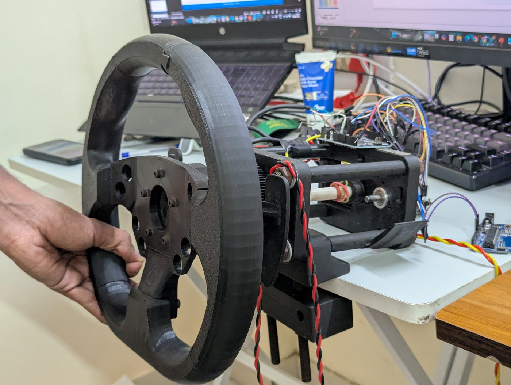

# sim-telemetry

[](https://github.com/RutuK2005/sim-telemetry/actions/workflows/ci.yml) [](LICENSE)

Telemetry logging for a home-built driving simulator. Demo video of the rig: https://www.youtube.com/watch?v=30tbnoA9A_E

[](https://www.youtube.com/watch?v=30tbnoA9A_E)

Our team built this rig for Smart India Hackathon 2025 and it won the internal round. An Arduino Leonardo reads the wheel, pedals and paddle shifters. This repo is my standalone rebuild of the logging side, not the code we ran at the hackathon. The microcontroller streams steering, throttle, brake, gear, speed and rpm as small binary packets over serial, and the Python side reads them, copes with corrupted or missing bytes, saves sessions to CSV or Parquet, shows a live dashboard in the browser and summarises a session with pandas.

You don't need the rig to try it. A simulated car drives laps around a track and sends the same packets. The parts list, build photos and cost breakdown are in [docs/hardware.md](docs/hardware.md).

## Running it 

```bash
python -m venv .venv
source .venv/bin/activate          # Windows: .venv\Scripts\activate
pip install -e ".[dev]"

sim-telemetry simulate --count 5                                 # print a few packets, hex and decoded
sim-telemetry record --port sim --out session.csv --seconds 30   # record 30 s from the simulated car
sim-telemetry analyze session.csv                                # summary of the session
sim-telemetry serve --source sim                                 # live dashboard on http://127.0.0.1:8000
```

With the rig plugged in, pass the serial port instead of `sim`, e.g. `--port COM3` or `--port /dev/ttyUSB0`. `--port loop://` runs the simulated car through pyserial's loopback port, so the bytes go through a real `Serial` object. `--noise 0.02` damages 2% of the simulated packets (dropped, a flipped bit, or junk bytes in front) if you want to see the error handling work. Use a `.parquet` file name to save Parquet instead of CSV (that needs pyarrow, which the dev extras include).

Recording runs in real time, so for a repeatable example generate a capture file and replay it:

```bash
sim-telemetry simulate --out capture.bin --seconds 120 --seed 1 --noise 0.02
sim-telemetry record --port capture.bin --out replay.csv
sim-telemetry analyze replay.csv
```

The record step ends with `saved 5924 frames ... dropped=76 crc_errors=40 bytes_skipped=1171`. Out of 6000 packets, 76 were lost (dropped by the fake link or thrown out because the CRC didn't match) and the rest came through, including the ones with junk in front of them. Part of the `analyze` output:

```
Samples            5924
Duration           120.0 s
Max speed          213.9 km/h
Average speed      129.3 km/h
Average throttle   64.9 %
Braking events     10
Dropped packets    76
```

## How it works

Every packet starts with a sync word (`0xAA 0x55`), carries a sequence number and the device's timestamp, and ends with a CRC-16. Serial only gives you a stream of bytes, so the parser keeps a buffer, looks for the sync word and checks the CRC. When a packet fails the check it skips one byte and searches again rather than throwing the whole chunk away, because the next good packet might start inside the bad bytes. Gaps in the sequence numbers give the dropped-packet count.

I put the reader in its own thread so the port keeps getting drained even when the disk or the browser is slow. Frames go onto a bounded queue. For a live source the oldest frame is dropped when the queue is full, since the newest reading is the useful one; when replaying a file it waits instead. The dashboard is FastAPI with a WebSocket and Chart.js, and it gets one batched update every 100 ms instead of one message per packet.

The device clock and the PC clock aren't synced, so latency on the dashboard is measured relative to the fastest frame seen. That still shows buffering and jitter, which is what matters for a live view.

The simulated car uses a basic lap model: corner speed is capped by grip, a forward pass limits how fast it can accelerate and a backward pass makes it brake in time for the next corner. Throttle, brake, steering, gear and rpm are worked out from that speed profile so they stay consistent with each other.

The packet is 20 bytes, little-endian. Values are scaled integers so the Arduino doesn't have to deal with floats.

| Bytes | Field | Notes |
|---|---|---|
| 0-1 | sync | `0xAA 0x55` |
| 2 | length | payload length (9) |
| 3-4 | seq | wraps at 65535 |
| 5-8 | timestamp | ms since the device booted |
| 9-10 | steering | units of 0.1 degree, negative = left |
| 11 | throttle | 0-100 % |
| 12 | brake | 0-100 % |
| 13 | gear | -1 reverse, 0 neutral, 1-6 |
| 14-15 | speed | units of 0.01 km/h |
| 16-17 | rpm | |
| 18-19 | CRC-16/CCITT-FALSE | over bytes 2-17 |

## Firmware

`firmware/sim_telemetry_reference/` has an Arduino Leonardo sketch for the rig's sensors (steering encoder on an interrupt, pedal pots, paddle switches) that sends this packet at 50 Hz. It's a reference sketch: it hasn't been flashed to the rig, and the pin numbers and pedal calibration are placeholders. Speed and rpm are sent as zero because on the real setup those come from the simulator on the PC. One of the tests builds a frame byte by byte the way the sketch does and checks it against `encode_frame`.

## Tests

```bash
pytest
ruff check .
```

The parser tests feed it random garbage, planted fake sync words and bit flips, split into random chunk sizes, and check that every good packet still comes out in order. `python scripts/bench_parser.py` times the parser. On my laptop (Python 3.14) it decodes over 130,000 packets/s, and a 115200-baud link can only carry about 576 of these packets per second, so pure Python is fast enough here.

## Limitations and next steps

The Python side has only been run against the simulated car and the loopback port, because the reference sketch isn't on the rig yet. So I don't have real numbers for noise or latency on the actual hardware.

Things I'd like to add:

- the clutch pedal (it's wired on the rig but there's no field for it, so it needs a v2 payload)
- sending force-feedback settings back to the device with the same framing
- lap detection and lap-by-lap comparison
