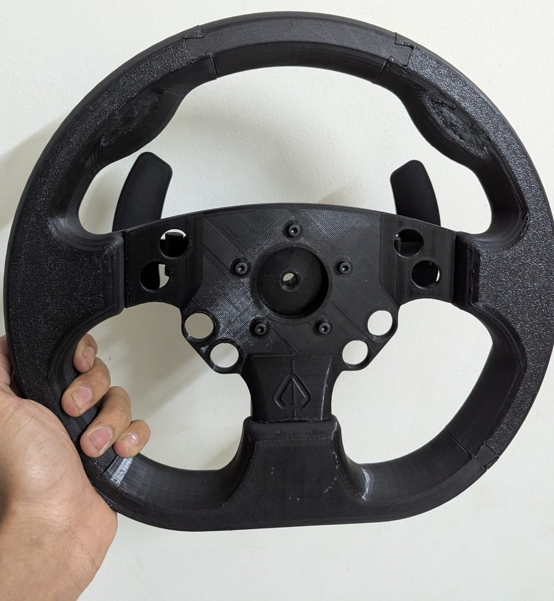
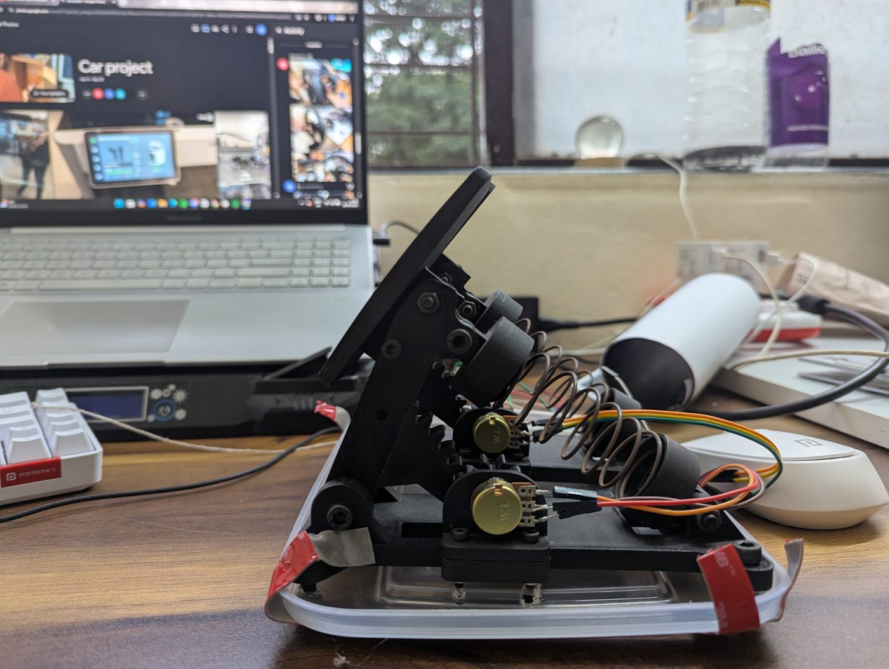
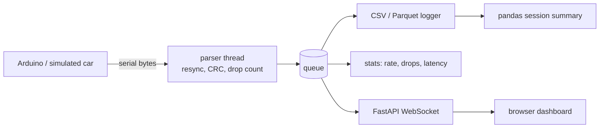

# sim-telemetry

[](https://github.com/RutuK2005/sim-telemetry/actions/workflows/ci.yml)  [](LICENSE)

▶️ **[Watch the driving-simulator rig in action (YouTube)](https://www.youtube.com/watch?v=30tbnoA9A_E)**

[](https://www.youtube.com/watch?v=30tbnoA9A_E)

Telemetry logging for a home-built driving simulator. A microcontroller on the rig streams steering, throttle, brake, gear, speed and rpm over serial. This Python side reads it, survives corrupted or dropped bytes, saves sessions to CSV/Parquet, shows a live dashboard in the browser, and summarises sessions with pandas.

It comes from the driving simulator our team built for Smart India Hackathon 2025 (we won the internal round). Hardware details, photos and the parts list are in [docs/hardware.md](docs/hardware.md). This repo is a standalone rebuild of the logging side, not the code we ran at the hackathon. It also runs without the rig: a built-in simulated car drives laps around a track and produces the same data.

| | |
|---|---|
|  |  |

## How it works



Serial is just a stream of bytes, so every packet starts with a sync word, carries a sequence number, and ends with a CRC. If a packet is corrupted, the parser skips one byte and searches again, so it doesn't lose the next good packet. Gaps in the sequence numbers show how many packets were dropped.

The reader runs in its own thread so the serial port is always drained even if the disk or the browser is slow. The dashboard gets one batched update every 100 ms instead of one message per packet.

## Packet format

20 bytes, little-endian:

| Bytes | Field | Notes |
|---|---|---|
| 0–1 | sync | `0xAA 0x55` |
| 2 | length | payload length (9) |
| 3–4 | seq | wraps at 65535 |
| 5–8 | timestamp | ms since the device booted |
| 9–10 | steering | 0.1°, negative = left |
| 11 | throttle | 0–100 % |
| 12 | brake | 0–100 % |
| 13 | gear | -1 reverse, 0 neutral, 1–6 |
| 14–15 | speed | 0.01 km/h |
| 16–17 | rpm | |
| 18–19 | CRC-16/CCITT | over bytes 2–17 |

Values are scaled integers rather than floats, which keeps packets small and easy to produce on an Arduino.

## Running it

```bash
python -m venv .venv
source .venv/bin/activate          # Windows: .venv\Scripts\activate
pip install -e ".[dev]"

sim-telemetry simulate --count 5                                   # print a few packets
sim-telemetry record --port sim --out session.csv --seconds 30     # record from the simulated car
sim-telemetry analyze session.csv                                  # max speed, braking events, gear usage...
sim-telemetry serve --source sim                                   # live dashboard on http://127.0.0.1:8000
```

With the real rig, use the serial port instead of `sim`, e.g. `--port COM3`. `--noise 0.02` corrupts 2% of packets on purpose, if you want to see the error handling work.

Example `analyze` output for a 2-minute simulated session:

```
Samples            5960
Max speed          213.9 km/h
Average throttle   64.6 %
Braking events     10
Dropped packets    40
```

## Firmware

`firmware/sim_telemetry_reference/` has an Arduino Leonardo sketch for the rig's sensors (steering encoder on an interrupt, three pedal pots, paddle switches) that sends this packet format at 50 Hz. It's a reference sketch and hasn't been flashed to the rig yet; pin numbers and calibration are examples.

## Tests

```bash
pytest
ruff check .
```

The parser tests feed it random garbage, fake sync bytes and bit flips to make sure it always recovers. In a quick benchmark on my laptop the parser handled about 186k packets/s, far more than a 115200-baud serial link can carry (around 576 packets/s), so pure Python is fine here.

## TODO

- Add the clutch pedal to the packet (needs a v2 payload)
- Send force-feedback settings back to the device using the same framing
- Lap detection and lap-by-lap comparison
